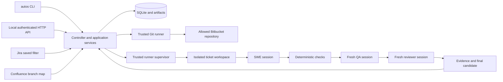

# Autos implementation plan

Build a local, testable system that continuously processes eligible bugs from a private Jira saved filter and produces reviewed feature branches. Deliver a synthetic end-to-end run first, then validate one real ticket, then enable ongoing filter processing. Use GPT-6 Luna workers for bounded implementation tasks and the primary agent for contracts, integration, and acceptance review.

## Starting point

The eight files in `Autos_MVP_Requirements_and_Starter_Docs/` describe a revision 3 MVP: a TypeScript controller, SQLite state, three coding CLI adapters, Jira and Confluence reads, Bitbucket Git operations, a bounded SWE/QA/reviewer loop, Docker deployment, and an OpenAPI 3.1 controller contract. The ZIP is the supplied archive. There is no application code, package manifest, or initialized Git repository in the project root.

The original documents remain unchanged. This plan resolves inconsistencies for implementation; it does not claim any planned command or endpoint already exists.

## Outcome and limits

For each selected bug, Autos resolves a unique allowed repository, pins the remote development branch SHA, creates `deep/<FULL_JIRA_KEY>` in an isolated workspace, implements a fix, executes configured checks, obtains independent QA and review, and permits at most two corrective rounds. Passing runs receive a feature-branch commit and a local evidence packet. Optional push targets that feature branch only.

One active ticket job is the MVP limit, even while several Luna workers build Autos in parallel. Tickets that cannot be resolved receive a local BLOCKED reason; the queue continues with other eligible tickets. “Process every ticket” means every eligible ticket receives an outcome. It does not mean claiming a fix when acceptance criteria, dependencies, tests, or review remain unresolved.

Jira and Confluence have no mutation capabilities in the MVP. Autos creates no PRs, merges, rebases, deployments, or production database changes. The scope follows the supplied proposal; autonomous merging would require a later scope decision.

## Decisions to establish before parallel coding

| Area | Proposed implementation decision | Reason |
| --- | --- | --- |
| Workspace | npm workspaces, TypeScript, one root lockfile | The proposal requests a TypeScript monorepo; npm is available locally. |
| Packages | `contracts`, `atlassian`, `cli-adapters`, `git-runner`, `workflow`, `runner` | The documents alternate between `providers` and `cli-adapters`; use one name. |
| Shared contracts | `packages/contracts` owns validated configuration, domain records, port interfaces, states, and artifact schemas | Workers need one agreed boundary before editing separate modules. |
| API | Fastify route schemas generate OpenAPI 3.1 | Matches the publishing guide; the starter YAML is a design reference until routes exist. |
| Job state | QUEUED, INVESTIGATING, PLANNED, IMPLEMENTING, QA, REVIEW, REVISING, READY_FOR_HUMAN, BLOCKED, CANCELLING, CANCELLED | Replace the checklist's alternate RESOLVED state; PLANNED distinguishes a completed dry-run from a validated fix. |
| Configuration | `jobs.max_parallel`, `jobs.max_repair_rounds`, `git.branch_template`, exact repository allowlist, and `security.allow_*` | Reconcile `instance.concurrency`, `repositories.*`, and alternate security field names before adapters are written. |
| Push | Configurable; disabled in the synthetic/local evaluation profile | The proposal supports optional push. A separate pilot configuration can enable it after acceptance gates. |
| Provider selection | Preserve Claude, Codex, and Cursor runtime adapters; allow a role-specific optional model | Choosing Luna to build Autos does not remove the product's three-provider requirement. |
| Atlassian platform | Target the Cloud APIs used by the proposal; verify the actual site's deployment before live integration | A Data Center installation would need different API clients. |
| MVP routing | One enabled repository per project | Reject ambiguous mappings; explicit component routing can be added when a real project needs it. |
| Artifacts | `artifacts/<issueKey>/<jobId>/` with a schema version | Multiple attempts must not overwrite earlier evidence. |

The foundation task will turn these decisions into executable contracts and a canonical configuration example. Workers request shared-contract changes through the orchestrator.

## Architecture

The `autos` CLI and authenticated local HTTP API call the same application services. The controller owns Jira/Confluence reads, SQLite claims, polling, orchestration, and artifact metadata. A trusted runner supervisor starts disposable job containers; coding agents receive scoped source access and only their provider's authentication. Git fetch, commit, and optional push belong to trusted code.

The controller must not expose its tokens or its API to coding-agent containers. Untrusted jobs receive no Docker socket or unrestricted host command interface. QA and reviewer cannot edit source; tests use writable build/output locations. Prompts describe these restrictions, but runner permissions and trusted adapters enforce them.

The local host has Node/npm, Docker, Git, Java/Maven, Claude, and Codex executables discoverable on PATH. Cursor's `cursor-agent`/`agent` executable and pnpm were not found on PATH. Binary presence does not establish authentication, Java compatibility, Docker daemon readiness, or permission to run unattended. These become `autos doctor` checks; they do not block fixture development.

## Filter processing and recovery

1. Read the configured private filter and its JQL using the configured identity. Page through the enhanced Jira search results. Snapshot issue content and apply allowed project, issue-type, and repository policies. A filter read failure must not look like an empty filter.
2. Persist discovery separately from execution. Polling is configurable and runs while the controller is running; starting a chat is not required to keep a deployed controller working.
3. Claim one eligible job transactionally in SQLite. Manual runs use the same eligibility and duplicate checks as polling. Default runs require membership in the configured filter; a bypass is outside the first MVP.
4. Use `(issue_key, repository, base_sha)` as attempt identity, with a separate active claim per issue/repository. A READY_FOR_HUMAN issue must not be rerun solely because the development branch advanced. BLOCKED jobs require explicit retry or a defined retryable failure policy.
5. On restart, recover expired claims and mark interrupted subprocess stages accurately. Do not silently create another branch or overwrite one. Resume only after validating workspace ownership, pinned base, configuration, and recorded stage evidence.
6. Filter removal preserves history and prevents new dispatch. Recheck membership and the issue snapshot before finalization; if they changed materially, stop with a recorded reason for reassessment.
7. One ticket's failure releases its claim and allows the next eligible ticket to run. Repeated service-wide failures use bounded backoff and remain visible to the operator.

## Per ticket execution

**Dry-run:** read the ticket, mapping, allowed remote branch metadata, and optional precedents; save the plan and routing evidence. Permit local state/artifact writes only. Launch no coding CLI, create no feature branch, commit nothing, and push nothing. Finish as PLANNED, never READY_FOR_HUMAN.

**Implementation:** fetch the mapped development branch, pin the actual fetched SHA, and create a new isolated feature branch. Root and relevant nested `AGENTS.md` rules accompany every role; preserve applicable native provider rules. Repository policies cannot override platform restrictions. Only SWE edits source and tests; new changed paths trigger instruction and path-policy checks before finalization.

**Validation:** establish the baseline, implement the change, and run the repository's configured deterministic commands. Store process exit codes, timeouts, and report paths. Give QA and reviewer independent sessions with issue requirements, base SHA, candidate diff, effective instructions, and evidence. Missing or malformed output and NOT_RUN checks cannot pass a required gate.

**Repair:** SWE receives actionable findings, then checks and independent review run again on the resulting candidate. Allow an initial pass plus at most two corrective rounds. Do not reuse a PASS report for changed source.

**Handoff:** stop source-writing processes, verify the final candidate matches the tested and reviewed content, enforce changed-path policy, stage explicit eligible paths, and commit. Refuse branch collisions and protected-branch targets. Record optional push success/failure separately so a push failure cannot discard a valid local commit or trigger another implementation attempt.

## Evidence contract

Each attempt records `issue.json`, `branch-map.json` with page ID/version, `base.json`, `precedents.md` with evidence or an explicit no-match, `implementation.md`, `checks.json`, `qa.json`, `review.json`, `summary.md`, and `manifest.json`. Provider transcripts are separate restricted artifacts. Hashes, timestamps, job/attempt IDs, repair round, candidate identity, and command outcomes connect evidence to the committed content.

The handoff includes repository identity, base branch and SHA, feature branch, commit SHA, changed files, checks, remaining limitations, and push outcome. API artifact responses return sanitized metadata rather than arbitrary filesystem paths or raw transcripts.

## Delivery sequence

| Milestone | Work | Completion evidence |
| --- | --- | --- |
| 0 Foundation | Initialize local Git, create workspace structure, shared contracts, canonical config, package scripts, and project instructions | Type checks pass; invalid policy/config examples fail clearly; worker boundaries are fixed. |
| 1 Independent modules | Build Atlassian reads, all three provider adapters, and Git operations in parallel | Mocked network contracts, fake CLI process tests, and disposable local Git tests pass. |
| 2 Product assembly | Build durable workflow/queue, CLI and local API, and fixture/container harness in parallel against shared ports | Public interfaces work with fakes; job state, cancellation, authentication, and API schemas are covered. |
| 3 Synthetic vertical slice | Integrate a seeded Java/Struts/JS bug with real subprocess execution | A failing regression becomes passing; independent role evidence and a feature commit match the final candidate. |
| 4 Live dry-run and one bug | Configure real filter, page, repositories, build profile, and approved CLI sessions | Correct routing is proven without writes, then one low-risk bug passes the full pipeline. |
| 5 Continuous intake and server | Exercise multiple filter tickets, restart recovery, then the on-prem deployment | No duplicate runs, one blocked ticket does not stop the queue, persistent artifacts survive restart, and service recovery works. |

Fixture coverage must include duplicate polls, mapping ambiguity, a disabled project, missing branch, existing feature branch, baseline failure, malformed provider output, timeout/cancellation, changed source after review, prohibited paths, injected ticket instructions, and prevented external mutations. Add tests with each behavior rather than postponing them to a final testing phase.

Support for all three provider adapters and OpenAPI documentation remains part of the MVP. A successful fixture using one provider is an intermediate milestone, not proof that all providers are ready.

## Luna implementation coordination

Use `gpt-6-luna` for implementation workers, initially with high reasoning and focused task briefs. Official [OpenAI subagent guidance](https://learn.chatgpt.com/docs/agent-configuration/subagents) supports explicit model selection and recommends narrow worker roles. Each worker receives the relevant requirements, shared contracts, owned paths, dependencies, and definition of done.

The primary agent owns shared contracts, root package/lock/configuration files, cross-module decisions, acceptance review, and integration. Workers own disjoint modules and their tests. With this session's four total agent slots, run at most three workers alongside the orchestrator. Six workstreams can run in two waves; six is a task split, not a requirement for six simultaneous agents.

Keep workers in the shared checkout with exclusive path ownership initially. Use isolated Git worktrees for tasks that need overlapping root changes or Git mutation. Workers report changed files, validation results, assumptions, and unresolved dependencies; they do not independently commit, push, or change shared contracts. The orchestrator reviews each handoff before integration.

## Inputs for the real pilot

Local foundation and fixture work can proceed without these. Collect them before live integration:

- Jira site and saved-filter URL/ID, plus an identity that can read the private filter.
- Confluence mapping page ID and actual Bitbucket workspace/repository values. Verify WTS `wakanda` and UWE `h1_phase2_dev` against the real remotes; they are proposal values, not verified access.
- Repository-specific Java/JDK/Maven/JavaScript commands, private artifact access, required test services, and permitted/prohibited paths.
- Approved authenticated Claude, Codex, and Cursor installations in the execution environment.
- One low-risk bug with reproducible behavior and acceptance criteria; whether the pilot should push its feature branch.

The later on-prem host request can proceed independently: Ubuntu/Docker, persistent encrypted storage, build capacity, approved outbound access, and an operational owner. It is not a prerequisite for writing the prototype.

## API implementation references

The proposal's Cloud integration design matches the documented [Jira filter read API](https://developer.atlassian.com/cloud/jira/platform/rest/v3/api-group-filters/), [enhanced JQL search](https://developer.atlassian.com/cloud/jira/platform/rest/v3/api-group-issue-search/), and [Confluence page read API](https://developer.atlassian.com/cloud/confluence/rest/v2/api-group-page/). Prefer the GET enhanced search operation initially. If a POST search operation becomes necessary for long JQL, allow only that explicit read operation; HTTP POST alone is not evidence of a Jira mutation.
